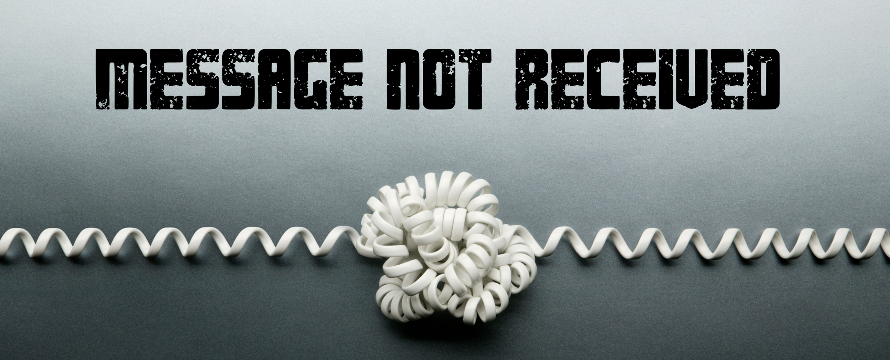

# Message not received

## Abstract

Somewhere between what a stakeholder intended and what was implemented in the code, the message was lost. Chances are, this wasn’t the first time this month. How often have you been caught between stakeholders who not only contradict each other but sometimes even themselves? How often do we slip into the same pitfall ourselves? This friction touches all of us: developers, architects, designers, product owners, managers, and yes, our stakeholders too. Communication is the hardest part of the job… And it's about to get harder, as we offload more of our writing and reading to AI. Stakeholders write fewer requirements themselves, developers read and think through fewer of the edge cases, and the nuance is quietly left to the interpretation of an AI.

Two decades in software engineering taught me this isn't a technology problem. It's a people problem — and it always has been. In this keynote, we'll look at these challenges and consider what happens when AI starts standing between us. We'll explore how we can understand each other across the table, identify where priorities genuinely diverge, and catch the nuances that AI-assisted communication quietly hides. These insights will help you navigate the tricky dynamics of stakeholder communication to build steady relationships, sharper requirements, and better systems, all while protecting our sanity along the way. Whether you're a stakeholder, a product owner, a designer, a developer, an architect, or a manager, you'll walk away with tools to turn communication friction into flow, with or without an AI in the loop.

## Is there a recording?

This session will be presented as the opening keynote at Hello Stavanger 2026.

## Additional information

Make sure to check the additional [resources](resources) for this topic.
